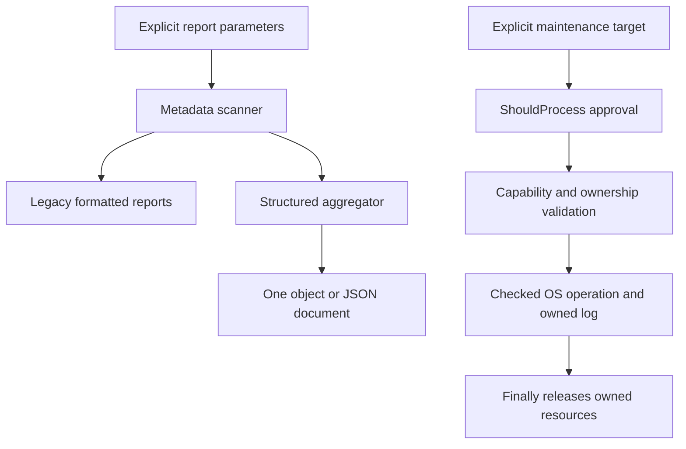

# Architecture

[README](../README.md) · [Commands](COMMANDS.md) · [Contributing](../CONTRIBUTING.md) · [Safety](SAFETY.md)

## Boundaries

- `src/DirectoryScan.ps1`: metadata traversal and report assembly; skips reparse/recall/offline entries and reports partial reads visibly.
- `src/DirectoryReview.ps1`: schema/versioned review aggregation with embedded warnings and bounded candidate retention; imports the shared scanner, not maintenance helpers.
- `src/UsbEject.ps1`: stable disk identity validation, PnP mapping, and a single checked native eject request. Native calls are behind replaceable PowerShell adapters.
- `src/DiskRecovery.ps1`: identity-based online and drive-letter recovery, including confirmation-time revalidation and collision refusal.
- `src/VhdMaintenance.ps1`: VHD preflight/owned attachment lifecycle, checked native commands, pagefile changes/rollback, and maintenance logging.
- `scripts/`: user entrypoints. They resolve imports from their own location, not the caller's current directory.
- `scripts/compat/`: thin aliases for old eject names. These are not alternative fallback strategies.
- `tools/ProjectTools.ps1`: exact dependency resolution, owned-source inventory, lint, test configuration, result gating, and optional coverage.
- Root `configure-defender-startup.ps1` and `verify-defender-startup.ps1`: separate local task configuration/inspection scripts. No toolkit entrypoint imports them. Their actual task behavior is outside the mocked test coverage; see the [Defender startup guide](DEFENDER-STARTUP.md).

The project intentionally uses small dot-sourced libraries rather than introducing a packaging/module layer merely for reorganization. Definitions do not run maintenance when a library is imported.

## State-changing operations

Guarded storage/maintenance entrypoints and the Handle diagnostic use `SupportsShouldProcess` and high-impact confirmation. Their `-WhatIf` paths perform no mutation; some return before full preflight. Reports do not need confirmation; LAN probes run immediately when explicitly invoked. The local Defender scripts do not implement this confirmation contract.

Maintenance and Handle logs are acquired atomically as new files and retained as owned streams until `finally` closes them; no failure path reopens a rejected caller-controlled path. Approval of a compound operation is explicit, but it does not make independent steps transactional. Helpers preserve their narrower guarantees: identity revalidation, owned attachment cleanup, and best-effort pagefile rollback.

`finally` is failure-path cleanup, not protection against process termination, power loss, concurrent device replacement, or driver bugs. Native commands and actual driver behavior require separately approved manual validation.

## Tests

Tests retain the previous safety cases and add layout, command, runner, and dependency contracts. External OS/native boundaries are replaced with throwing stubs and mocks. Filesystem integration uses small disposable local fixtures; external sentinels verify junction cleanup does not delete linked targets.

The syntax inventory includes all root `.ps1`/`.psd1` files and recursively includes `.ps1`/`.psm1`/`.psd1` files under `src`, `scripts`, `tools`, and `tests`. It excludes `.tools`, `.local`, `archive`, and `artifacts`; dependency XML is not PowerShell source. Root files are discovered from the working tree, including untracked additions, rather than from a fixed filename allowlist. Production lint uses the same inventory without `tests`.

Pester and PSScriptAnalyzer versions, download URLs, and package SHA-512 hashes are pinned in [Dependencies.psd1](../tools/Dependencies.psd1). Dependencies install only inside `.tools`; test execution does not contact the network. TestRegistry is disabled, and failure/skip/empty-run conditions fail validation.

## Quality gates

- Parsing runs with each CI lane's parser: Windows PowerShell 5.1 and PowerShell 7.
- PSScriptAnalyzer uses the explicit rules in the root settings file. These cover unsafe dynamic evaluation, credentials, weak hashes, empty catches, overwritten built-ins, encoding, and compatible syntax. All diagnostics from those configured rules fail the gate. This is not an assertion that every optional style rule is enabled.
- The full unit/contract suite is mandatory. Diagnostic `-SkipLint` is never used by CI.
- Coverage instruments reusable `src` source only. [Quality.psd1](../tools/Quality.psd1) sets the command-coverage minimum, currently **90%**, for coverage-enabled runs. CI always enables coverage. Missing/empty/invalid coverage fails closed. Native C# and real hardware are not validated by a percentage; do not lower the threshold to hide a missing safety case.

Generated artifacts are per-engine NUnit XML, lint JSON, environment metadata, and optional JaCoCo coverage. They are local/CI outputs, not checked-in evidence of a current successful run.

## Large-file report selection

`Get-DirectoryLargeFileReport` consumes one metadata traversal and retains at most `Top` rows in each of its image and ordinary-file categories. Binary insertion orders retained rows by exact Int64 byte length; equal sizes retain encounter order. Each category temporarily holds at most `Top + 1` rows during insertion. Candidate storage is therefore proportional to `Top`, with at most `Top` shifts per accepted row. The scanner still keeps its directory traversal stack, and the report still visits all readable entries.

Images qualify regardless of size; ordinary files must be strictly larger than `MinimumFileBytes`. Unreadable entries and skipped links retain the existing partial-scan warning behavior. Selection does not estimate reclaimable space or authorize maintenance. Tests cover category separation, cutoff ties, empty results, exact large integer ordering, a single traversal, and partial-scan retention.

## Data flow and rationale

Report output never feeds an automatic mutation step. The structured aggregator merges the scanner warning stream into its input stream to count all warnings while retaining only `WarningLimit` samples; candidates use a bounded list with sorting after overflow. Counts describe all readable metadata, not just retained rows. Candidate storage is O(Top + WarningLimit); directory traversal still has its own stack and no duration bound. The independent legacy selector uses binary insertion and encounter-order ties to preserve its established interface. Unifying those tie/threshold rules would silently change consumers, so the two contracts remain explicit.

The object schema is the integration boundary; `src` functions are internal dot-sourced helpers, not a versioned public module API. See the [field contract](COMMANDS.md#schema-1-output-contract). There is no backend, persistent application database, authentication system, telemetry, package installer, or automatic report retention. Runtime state consists of explicit OS changes, newly acquired logs, and the separate Defender task. JSON serialization does not persist state.

## Ownership and failure boundaries

USB mutation resolves one non-system USB identity and revalidates its mapping after confirmation. A successful eject result means Windows accepted the request, not independent proof the device is physically absent. Online/letter commands verify readback and refuse ambiguous partitions or occupied letters.

VHD preflight validates the path, required Storage command parameters, detached state, and exclusive access. Compaction rechecks and acquires a read-only attachment without a drive letter; its `finally` releases only that attachment. Exclusive access is a point-in-time check, not a permanent concurrency lock. The native adapter checks exit status; DiskPart compaction also requires a recognized success acknowledgement. Logs retain diagnostics but are not signed forensic receipts.

WMI pagefile updates snapshot the existing automatic-management flag and exactly one C: setting, verify readback, and attempt rollback on failure. The registry alternative snapshots `PagingFiles`, changes only one C: entry, and verifies each string. Rollback can itself fail and is reported as a warning. Neither mechanism rolls back an earlier successful hibernation change or a later independent compaction failure. Operators must inspect current state before retrying.

The toolkit inventories local files; it does not own provider acquisition, market-data retention, broker execution, or research acceptance. Those application owners must decide which snapshots, checkpoints, caches, or results can be removed. The Docker/Ubuntu reference filenames are historical labels, not deployed services or proof of a current runtime installation.
